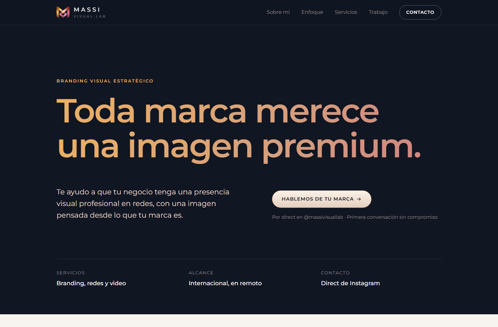
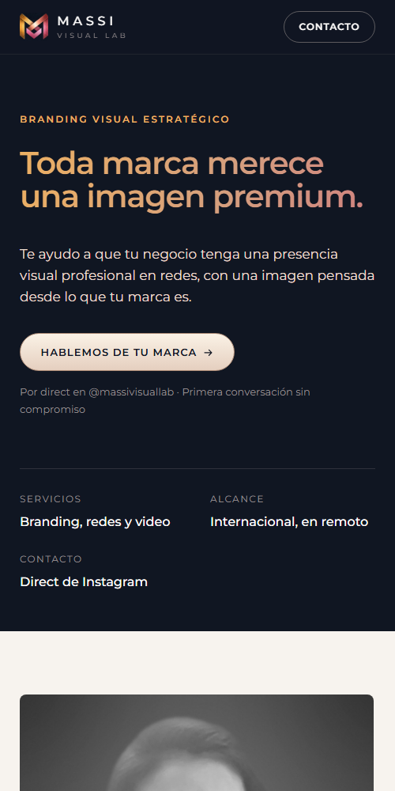

# Massi Visual Lab · Landing page

Landing page (MVP) de **Massi Visual Lab**, marca de branding visual estratégico, gestión de redes y video para negocios. Todo el contacto se dirige a mensajes directos de Instagram ([@massivisuallab](https://www.instagram.com/massivisuallab/)).

| Escritorio | Móvil |
|---|---|
|  |  |

## Tecnología

HTML, CSS y JavaScript sin frameworks ni dependencias. No necesita compilación: los archivos se publican tal cual.

```
index.html        Contenido y estructura de la página
styles.css        Estilos (paleta de marca, diseño adaptable, modo de alto contraste)
lp-massiel.js     Generador del primer mensaje, barra fija en móvil, medición de clics
img/              Retrato, monograma, favicon, imagen para compartir y piezas del portafolio
```

## Secciones

1. **Portada**: propuesta de valor y botón a Instagram.
2. **Sobre mí**: retrato y presentación de Massi.
3. **Enfoque**: por qué importa una imagen estratégica.
4. **Servicios**: branding visual, gestión de redes y video.
5. **Trabajo**: proyecto conceptual destacado (cafetería artesanal en Manaos).
6. **Contacto**: pasos para empezar y un formulario que arma el primer mensaje y lo copia antes de abrir Instagram.

## Ver la página en local

Basta con abrir `index.html` en el navegador. Para que funcione el botón de copiar al portapapeles, conviene servirla por `http://localhost`:

```bash
python -m http.server 8000
# luego abrir http://localhost:8000
```

## Publicación

Al ser un sitio estático, se puede publicar en GitHub Pages, Netlify, Vercel o cualquier hosting de archivos. Después de publicar:

- Activar en `index.html` las etiquetas `og:image` y `canonical` con el dominio definitivo (están comentadas y marcadas como `[información por confirmar]`).

## Medición

Cada botón de contacto tiene un atributo `data-cta`. Si el sitio carga Google Tag Manager, cada clic envía `{ event: 'cta_instagram', ubicacion: '...' }` a `dataLayer`.

## Pendientes

Los puntos por confirmar están marcados en el código con `[información por confirmar]`:

- Logotipo y monograma en formato vectorial (SVG); en el reel del logotipo aparece «Virtual Lab» y en la cuenta «Visual Lab».
- Colores exactos del manual de marca y tipografía oficial (hoy se usa Montserrat como aproximación).
- Colores exactos e imágenes completas del proyecto de la cafetería.
- Retrato en alta resolución (el actual se editó a partir de una foto de 445 × 604 px).
- Dominio definitivo.
